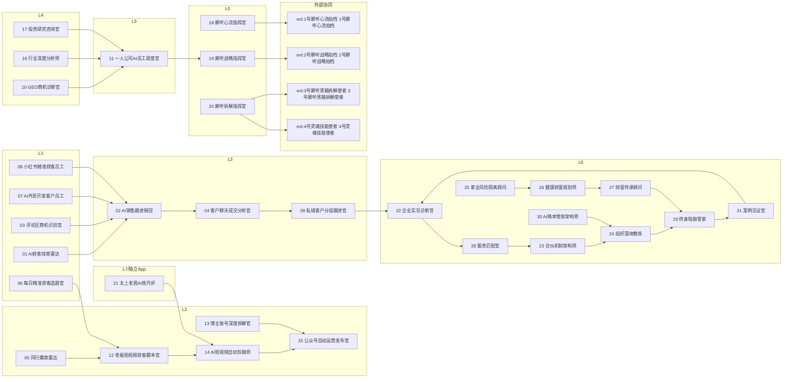

# 31 位数字员工 · 协同 DAG 图谱与链路健康检查

- 总节点数：**35**（agent-team 内部 31 + 外部协同 4）
- 总边数：**31**

## 协同流程图（Mermaid）

## 链路健康检查

✅ **链路断裂**：0 条（所有下游交接均指向已声明节点）
✅ **孤岛节点**：0 个（每个内部节点至少有一条入边或出边）
- **源头节点**（无入边、有出边，漏斗入口）：['01', '03', '05', '06', '07', '08', '10', '13', '16', '17', '18', '20', '21', '25', '30']
- **终点节点**（有入边、无出边）：['15']
- **回流闭环**（有向环，设计内可接受的年度复诊/复盘回路）：
  - 22 → 28 → 23 → 24 → 29 → 31 → 22

✅ **协同漂移告警**：无（collab_map 与 L0/L6 代码 handoff_to 一致）

## 节点清单

| 编号 | 名称 | 层 | 出边 | 入边 |
| --- | --- | --- | --- | --- |
| 01 | AI获客线索雷达 | L1 | 1 | 0 |
| 02 | AI销售跟进销冠 | L3 | 1 | 4 |
| 03 | 评论区商机识别官 | L1 | 1 | 0 |
| 04 | 客户聊天成交分析官 | L3 | 1 | 1 |
| 05 | 同行爆款雷达 | L2 | 1 | 0 |
| 06 | 每日精准获客选题官 | L1 | 1 | 0 |
| 07 | AI外贸开发客户员工 | L1 | 1 | 0 |
| 08 | 小红书精准获客员工 | L1 | 1 | 0 |
| 09 | 私域客户分层跟进官 | L3 | 1 | 1 |
| 10 | GEO商机诊断官 | L4 | 1 | 0 |
| 11 | 一人公司AI员工调度官 | L5 | 1 | 3 |
| 12 | 老板短视频获客脚本官 | L2 | 1 | 2 |
| 13 | 博主账号深度拆解官 | L2 | 1 | 0 |
| 14 | AI短视频自动剪辑师 | L2 | 1 | 2 |
| 15 | 公众号自动运营发布官 | L2 | 0 | 2 |
| 16 | 行业深度分析师 | L4 | 1 | 0 |
| 17 | 投资研究咨询官 | L4 | 1 | 0 |
| 18 | 卿听心流指挥官 | L0 | 1 | 0 |
| 19 | 卿听战略指挥官 | L0 | 1 | 1 |
| 20 | 卿听拆解指挥官 | L0 | 2 | 0 |
| 21 | 太上老君AI炼丹炉 | L7/独立App | 1 | 0 |
| 22 | 企业实况诊断官 | L6 | 1 | 2 |
| 23 | 合伙机制架构师 | L6 | 1 | 1 |
| 24 | 组织落地教练 | L6 | 1 | 2 |
| 25 | 家业风险隔离顾问 | L6 | 1 | 0 |
| 26 | 健康财富规划师 | L6 | 1 | 1 |
| 27 | 财富传承顾问 | L6 | 1 | 1 |
| 28 | 服务匹配官 | L6 | 1 | 1 |
| 29 | 终身陪跑管家 | L6 | 1 | 2 |
| 30 | AI降本增效架构师 | L6 | 1 | 0 |
| 31 | 案例见证官 | L6 | 1 | 1 |
| ext:1号卿听心流拍档 | 1号卿听心流拍档 | 外部协同 | 0 | 1 |
| ext:2号卿听战略拍档 | 2号卿听战略拍档 | 外部协同 | 0 | 1 |
| ext:3号卿听黑箱拆解使者 | 3号卿听黑箱拆解使者 | 外部协同 | 0 | 1 |
| ext:4号灵魂技能使者 | 4号灵魂技能使者 | 外部协同 | 0 | 1 |
