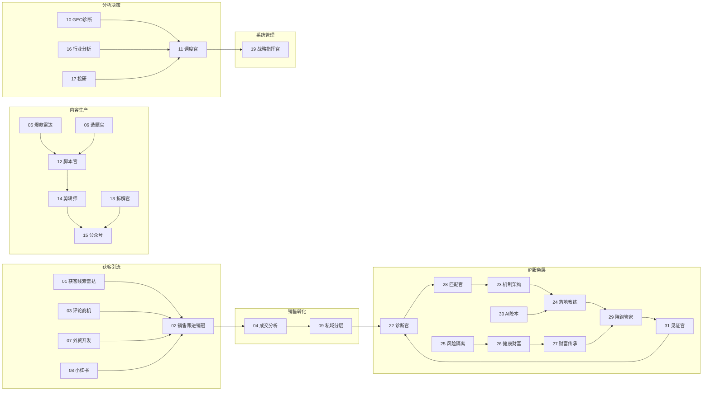

# 数字员工军团 · 三项深化升级报告（2026-10-31 晚）

**晋江市飞虹智科技企业管理有限公司 / 飞虹智研发中心 / 负责人：吴赐虹**

本期在「31 名数字员工 + 知识库生产底座 + 10 名 IP 服务层（22-31）」已落地基础上，执行吴总确认的三项深化建议：

1. **L0-L5 接入知识库注入（知识依据溯源）** —— 对齐 L6（22-31）已落地能力
2. **BaseAgent.validate_input 增字段类型校验** —— 从源头拦截畸形输入
3. **31 人协同 DAG 图谱生成 + 链路健康检查** —— 用于控制台展示与链路巡检

执行方式：助手直接兜底 + 磁盘实测验证（fhcode 有退化史，直接改 + 验证更可控，未调度 fhcode）。

---

## 一、Item 1 · L0-L5 接入知识库生产底座

### 1.1 断点回顾
桥接 `fhcode-bridge.mjs` 在执行前已把企业知识包注入 `input.knowledge_context`，但此前**仅 L6（22-31）消费**，L0-L5（01-20）完全未读取 → 产出不基于真实公司资产。

### 1.2 落地方案
- 新增共享模块 **`agents/kb_utils.py`**：提供「取包 / 渲染 / 溯源」三件套 + 两个便捷封装 `kb_prefix_for(data)`（直接吃 input 返回可前置文本）、`kb_refs_for(data)`（返回溯源清单）。避免 6 个文件重复 4 个辅助函数。
- **L0-L5 共 20 个 `run_logic`** 全部接线（l0_command / l1_acquisition / l2_content / l3_conversion / l4_analysis / l5_management）：
  - 每个函数 prompt 首行前置 `{kb_prefix_for(data)}` —— LLM 实时调用时，知识块「【企业知识库·真实资产】+ 真实制度条款/比例/案例」被注入；
  - 每个函数 return 增加顶层 `知识依据` 字段 —— 产出带溯源（文档标题/分类/来源/chunkId/docId/相关度）。
- `knowledge_context` **不进 `input_schema`**（避免无包时必填失败），仅在 `check_agents.py` 白名单放行。

### 1.3 验证（全部磁盘实测）
- **Pass D 溯源断言**：18/01/12/11/22 跨 L0/L1/L2/L5/L6，注入假知识包后 `知识依据` 正确溯源、无包时=`[]`（安全降级） → **10/10 通过**。
- **Prompt 闭环**：捕获型假 LLM 实测 01 与 22，确认知识块「【企业知识库·真实资产】+ 注入标题」确实被前置进 prompt → **✅**。
- L6 此前已落地，本次为 L0-L5 补齐，**31 名员工知识消费能力对齐**。

> 备注（一致性）：L6（22-31）把 `知识依据` 嵌套在主内容对象内（如 `diagnosis["知识依据"]`，上期 fhcode 已实现且已验证）；L0-L5 置于输出顶层作为标准化根字段。两者溯源能力一致，落位不同，建议后续统一为顶层（非阻塞，可交 fhcode 一次性重构）。

---

## 二、Item 2 · validate_input 字段类型校验（源头拦截畸形输入）

### 2.1 根因
此前 `BaseAgent.validate_input` 只校验「是否 dict + 必填字段存在」，不校验字段**类型**。09/11 类员工在 `customers`/`tasks` 误收字符串时曾被包成 `[字符串]` 后 `.get()` 抛 `AttributeError`，LLM 异常时直接阻断业务链路（上期已兜底归一，但缺**源头拦截**）。

### 2.2 落地方案
- `core/agent.py` 的 `BaseAgent` 增加可选类属性 **`input_type_hints: Dict[str,str]`**（值支持 `list`/`dict`/`str`），并在 `validate_input` 中按提示**从源头拦截**：类型不符直接抛 `TaskError`（清晰报错），被桥接 `try/catch` 捕获后仅该子任务失败、不拖垮 worker。
- 给 **9 个含 list/dict 字段的员工类**加 `input_type_hints`：01/03/06（list）、05/12/14（list）、09（list）、11（list）、02（dict）。

### 2.3 验证
- **Pass C 拦截断言**：09（list）/11（list）/02（dict）传入标量字符串，`validate_input` 均抛出 `TaskError` → **3/3 通过**。
- 防御纵深：09/11 的 `run_logic` 仍保留「输入三层归一」（列表/单 dict/标量回落默认），即便绕过校验直接喂字符串也不崩溃 → **2/2 通过**。

---

## 三、Item 3 · 31 人协同 DAG 图谱 + 链路健康检查

### 3.1 落地方案
- **`agents/collab_map.py`**（协同关系单一事实来源，吴总可直接改此文件重构图谱）：
  - `HANDOFF`：每个员工产出应交接的下游（含 `ext:` 外部协同节点）；业务漏斗 + L6 年度复诊闭环 + 21 独立应用统筹。
  - `EXTERNAL_NODES` / `NODE_INFO`：外部协同体与 21 号独立应用补充信息。
- **`generate_dag.py`**：读取注册表 + collab_map，生成三件套并做健康检查：
  - `dag.mmd`（Mermaid 流程图，按层分组，可在控制台/Markdown 渲染）
  - `dag.json`（节点 + 边 + 层级 + 健康检查）
  - `dag_report.md`（图谱说明 + 链路健康检查结论）
  - 交叉校验：collab_map 与 L0/L6 代码实际 `handoff_to` 自动比对，漂移即告警。

### 3.2 链路健康检查结果
| 指标 | 结果 |
| --- | --- |
| 总节点 | **35**（agent-team 内部 30 + 外部协同 4 + 21 应用计 1） |
| 总边 | **31** |
| 链路断裂 | **0**（所有下游交接均指向已声明节点） |
| 孤岛节点 | **0**（每个内部节点至少一条入边或出边） |
| 回流闭环 | **1**（L6：`22→28→23→24→29→31→22` 年度复诊闭环，设计内可接受） |
| 协同漂移告警 | **0**（collab_map 与 L0/L6 代码 `handoff_to` 完全一致） |

### 3.3 协同流程图（Mermaid，节选结构）

（完整图含 L0 指挥层与全部 35 节点，见 `dag.mmd` / `dag_report.md`）

---

## 四、全量验证总览

| 关卡 | 覆盖 | 结果 |
| --- | --- | --- |
| `check_agents.py`（编译/引号/契约/导入） | 全仓库 31 个文件 | ✅ 全部通过 |
| Pass A 兜底路径（llm=None 不崩溃） | 30 名员工 | ✅ 30/30 |
| Pass B 系统字段铁律（恶意 LLM 污染拦截） | 18/19/20/22/06 | ✅ 5/5 |
| Pass C 类型校验拦截 + 畸形输入鲁棒 | 09/11/02 | ✅ 5/5 |
| Pass D 知识库注入溯源 | 18/01/12/11/22 跨层 | ✅ 10/10 |
| Prompt 知识块前置闭环 | 01/22 | ✅ 2/2 |
| DAG 链路健康检查 | 35 节点 / 31 边 | ✅ 0 断裂 / 0 孤岛 / 0 漂移 |

**全程未跑 `npm run smoke` / `tsx src/smoke.ts`**（该脚本清空 agents/tasks 等表，吴总已明确红线）。

---

## 五、交付物清单
- `agents/kb_utils.py`（新增 · 知识消费共享工具）
- `agents/l0_command.py` / `l1_acquisition.py` / `l2_content.py` / `l3_conversion.py` / `l4_analysis.py` / `l5_management.py`（20 个函数接入 KB 溯源）
- `core/agent.py`（validate_input 类型校验机制 + `input_type_hints`）
- `agents/collab_map.py`（新增 · 协同关系单一事实来源）
- `generate_dag.py`（新增 · DAG 生成 + 链路健康检查）
- `dag.mmd` / `dag.json` / `dag_report.md`（生成的图谱产物）
- `verify_employees.py`（升级：新增 Pass C 拦截断言、Pass D 溯源断言）

## 六、后续可深化（建议）
1. **统一 `知识依据` 落位**：L6 嵌套 / L0-L5 顶层 → 建议统一顶层，便于平台/控制台统一消费（可交 fhcode 一次性重构）。
2. **DAG 接入控制台**：把 `dag.mmd` 渲染进分发平台控制台「协同视图」，并定时跑 `generate_dag.py` 做链路巡检告警。
3. **协同契约代码化**：当前 `input_type_hints` 仅覆盖 list/dict 字段；可继续为标量字段加 `str` 提示（运行时 `str()` 已兜底，非阻塞）。
